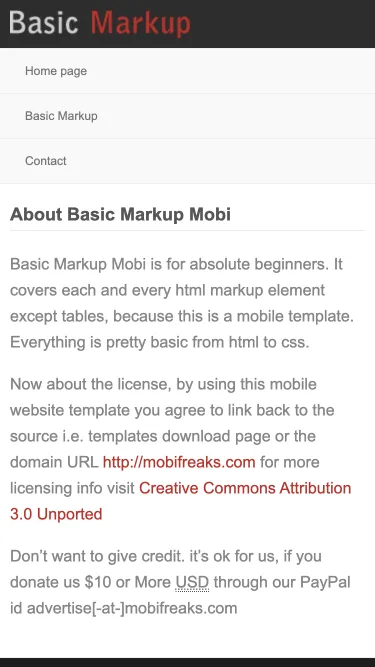

# Basic Markup

Basic Markup: a bare starting point for a mobile website, with a contact page and typography reference.

**[Live demo](https://mobifreaks.munawarahmed.com/Basic-Markup-Mobi/)** ·
[Download zip](https://github.com/mobifreaks/Basic-Markup-Mobi/archive/HEAD.zip) ·
[All 22 templates](https://munawarahmed.com/mobifreaks)

## Use it

No build step. Download the zip, open `index.html`, and replace the placeholder text and images with your own.

## Tech

HTML and CSS. No JavaScript.

## License

MIT, see [LICENSE](LICENSE). Keeping the "Design by Mobifreaks" credit in the footer is appreciated, not required.

---

Built by [Mobifreaks](https://munawarahmed.com/mobifreaks), the first project of [M Munawar Ahmed](https://munawarahmed.com).
